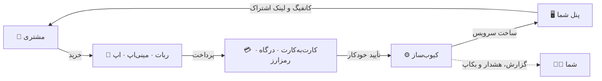
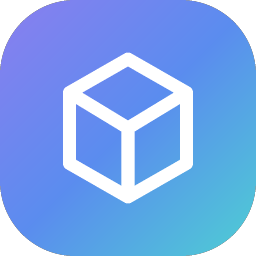

**فروشگاه VPN تلگرامی شما، آماده در چند دقیقه.** 
پرداخت، تحویل کانفیگ، تمدید، هشدار اتمام حجم، نمایندگی و گزارش‌ها همه خودکار است — 
در ربات تلگرام، مینی‌اپ، پنل وب و اپ اندروید، همه با نام و برند خودتان.

[**🚀 ساخت ربات در @cubesaz_bot**](https://t.me/cubesaz_bot) &nbsp;·&nbsp; [**📋 همهٔ ۲۹۹ قابلیت**](https://cubepy.github.io/cubesaz-site/#features) &nbsp;·&nbsp; [**📢 کانال**](https://t.me/CubeSaz)

 

##  سه قدم تا اولین فروش

| | | |
|:--:|---|---|
| **۱** | **ربات را در BotFather بسازید** | یک ربات خالی با نام دلخواه بسازید و توکنش را بردارید. |
| **۲** | **توکن را به [@cubesaz_bot](https://t.me/cubesaz_bot) بدهید** | چند ثانیه بعد ربات فروش شما روشن است؛ نصب، سرور و دیتابیس با ما. |
| **۳** | **سرور وصل کنید و بفروشید** | در ربات خودتان `/panel` بزنید، پنل را اضافه کنید، محصول بسازید و روش پرداخت را روشن کنید. |

نه هاستی می‌خرید، نه چیزی نصب می‌کنید، نه یک خط کد می‌نویسید.

##  یک فروشگاه، چهار در

مشتری از هر جا که راحت است خرید می‌کند، و همه روی **یک دیتابیس** است: موجودی، سرویس‌ها و سفارش‌ها همه‌جا یکی‌اند.

| | |
|---|---|
| 🤖 **ربات تلگرام** | با نام و آیدی خودتان. منوی کامل خرید، تمدید، کیف پول، تست و پشتیبانی؛ مدیریت کامل هم از داخل همین ربات. |
| 📱 **مینی‌اپ** | یک فروشگاه واقعی داخل تلگرام: خرید، تمدید، حجم اضافه، شارژ کیف پول و رسید پرداخت — بدون تایپ حتی یک دستور. |
| 🖥 **پنل وب** | مدیریت فروشگاه از مرورگر: سرورها، محصولات، کاربران، گزارش‌ها، متن‌ها و تنظیمات، با قفل IP. |
| 🤳 **اپ اندروید اختصاصی** | اپ VPN با نام، لوگو، رنگ و پشتیبانی خودتان — و اگر بخواهید وصل به همین ربات برای خرید و تمدید داخل اپ. |

##  از نگاه مشتری

##  پشت صحنه

شما فقط وقتی لازم است وارد ماجرا می‌شوید: رسیدی که خودکار تأیید نشده، تیکتی که جواب می‌خواهد، یا تصمیمی که فقط با شماست.

##  پنل‌ها

**۲۳ نوع پنل، هم‌زمان روی یک ربات.** هر تعداد سرور، هرکدام با تعرفه، محصولات و تنظیمات خودش.

| | | | |
|---|---|---|---|
| مرزبان · Marzban | مرزنشین · Marzneshin | هیدیفای · Hiddify | ثنایی · 3X-UI |
| علیرضا · Alireza X-UI | پاسارگارد · Pasarguard | آسان پنل · AsanPanel | VPN-UI |
| گارد ۲ · GoGuard | نودکس · Nodex | S-UI | Remnawave |
| ربکا · Rebecca | ریک پنل · RickPanel | HPX Panel | WGDashboard |
| تانل‌لاین · Tunnelline | OV-Panel | میکروتیک · MikroTik | IBSng |
| کانکتیکس · Connectix | شاهراه · Shahrah | فروش دستی · انبار کانفیگ | |

سرورتان داخل ایران است و از بیرون بسته می‌شود؟ **پروکسی سرور ایران برای اتصال به ربات** را از [@cubesaz_bot](https://t.me/cubesaz_bot) بگیرید تا تماس‌های ربات از مسیر داخلی عبور کند.

##  پرداخت

**۱۲ روش پرداخت، آماده.** هرکدام با یک دکمه روشن و خاموش می‌شود؛ تأیید پرداخت و تحویل سرویس خودکار است.

| روش | |
|---|---|
| 💳 **کارت‌به‌کارت** | تأیید خودکار با پیامک بانک (۱۴ بانک)، چند کارت، ضد رسید جعلی |
| 🧾 **پرداخت با رسید** | مشتری فقط عکس رسید را می‌فرستد |
| 🏦 **زرین‌پال · آقای پرداخت · کیوب‌پی** | درگاه ریالی؛ در کیوب‌پی کارمزد به انتخاب شما |
| 🪙 **ترانزو · ترنادو · Plisio · NOWPayments** | تتر، ترون و رمزارزهای بین‌المللی |
| 🔐 **رمزارز آفلاین** | واریز مستقیم به ولت خودتان (TON، TRX، USDT) با بررسی خودکار تراکنش |
| ⭐️ **ستارهٔ تلگرام** | پرداخت داخل خود تلگرام، بدون درگاه بیرونی |
| 👛 **کیف پول** | شارژ یک‌باره و خرید با یک ضربه از موجودی |

##  اپلیکیشن اندروید اختصاصی

<b>همهٔ قابلیت‌های اپ</b>

 

- **هستهٔ Xray** — VLESS، VMess، Trojan، Shadowsocks، WireGuard و Hysteria2
- **اتصال به سریع‌ترین سرور** موقع وصل شدن، و هشدار وقتی وصل است ولی اینترنت رد نمی‌شود
- **برند کامل** — نام، لوگو، ده رنگ‌بندی و پنج چیدمان صفحهٔ اصلی؛ قاب لوگو خودکار
- **پیش‌نمایش پیش از ساخت** — آیکون و صفحهٔ اصلی را قبل از ساخت می‌بینید
- **مسیریابی هوشمند و کیل‌سوییچ** — سایت‌های ایرانی مستقیم، بقیه از تونل
- **مسدودکردن تبلیغات** با یک کلید، اختیاری برای مشتری
- **پیام خطای واضح** برای لینک اشتراک: لینک باطل، سرور بی‌جواب یا اینترنت قطع
- **آپدیت از داخل خود اپ**، منظم و حداکثر هر دو هفته یک بار
- **اتصال اپ به ربات** — ورود، «سرویس‌های من»، خرید و تمدید داخل اپ
- **نسخهٔ دمو** پیش از خرید، و ساخت در حدود ۱۰ دقیقه بعد از پرداخت

##  چرا کیوب‌ساز

| | **کیوب‌ساز** | اسکریپت روی هاست خودتان | فروش دستی |
|---|:--:|:--:|:--:|
| خرید و نگه‌داری سرور ربات | ✅ لازم نیست | ❌ با شما | — |
| نصب و آپدیت | ✅ خودکار | ❌ با شما | — |
| بکاپ | ✅ خودکار، در کانال خصوصی شما | ⚠️ با شما | ❌ |
| تأیید پرداخت شبانه‌روزی | ✅ خودکار | ⚠️ بسته به اسکریپت | ❌ نصفه‌شب بیدار شدن |
| چند نوع پنل روی یک ربات | ✅ ۲۳ نوع | ⚠️ معمولاً چند نوع | — |
| مینی‌اپ و پنل وب | ✅ | ⚠️ | ❌ |
| اپ اندروید با برند شما | ✅ | ❌ | ❌ |
| انتقال از میرزا، میرزا پرو و DDbot | ✅ با همان ربات و یوزرنیم | — | — |

##  هزینه

| | |
|---|---|
| 🎁 **۷ روز رایگان** | برای اولین ربات، بدون کارت بانکی و بدون تعهد |
| 💵 **$4 برای هر ۳۰ روز** | اولین پرداخت با **۵۰٪ تخفیف** ($2) |
| 📱 **اپ اندروید** | اشتراک جدا و اختیاری؛ دموی آن را پیش از خرید ببینید |

قیمت روز همیشه در [@cubesaz_bot](https://t.me/cubesaz_bot) است.

##  تازه‌ها

<b>مهر ۱۴۰۵ · اکتبر ۲۰۲۶</b>

 

- 🌐 **دامنهٔ تازه** — مینی‌اپ و سایت حالا از داخل ایران بدون فیلترشکن باز می‌شوند
- 👁 **پیش‌نمایش اپ** پیش از ساخت: آیکون، رنگ‌بندی و صفحهٔ اصلی
- 📦 **آپدیت منظم اپ** — حداکثر هر دو هفته یک بار، از داخل خود اپ
- 🤝 **پیام محترمانهٔ پایان اشتراک اپ** — مشتری فقط «سرویس موقتاً در دسترس نیست» می‌بیند
- ⚡️ **اپ ۱.۹** — Hysteria2، اتصال به سریع‌ترین سرور، هشدار «بدون اینترنت»، مسدودکردن تبلیغات و حجم بسیار کمتر
- 🎁 **هدیهٔ خوش‌آمد** — شارژ کیف پول مشتری تازه بعد از تأیید شماره
- 🔀 **پروکسی سرور ایران** — درخواست، صورت‌حساب و رسید همه داخل ربات
- 🛡 **وایرگارد چندتانلی** — هر تانل فایل و QR جدا

همهٔ تغییرات در [CHANGELOG.md](CHANGELOG.md).

##  سؤال‌های رایج

<b>با خرید کیوب‌ساز دقیقاً چه چیزی تحویل می‌گیرم؟</b>

 یک ربات فروش اشتراک VPN با برند خودتان و دیتابیس جدا، به‌همراه مینی‌اپ تلگرام و پنل مدیریت تحت وب؛ هر سه روی یک دیتابیس. نیازی به هاست یا نصب ندارید. اپلیکیشن اندروید اختصاصی محصول جداگانه و اختیاری است.

<b>مشتری‌هایم می‌فهمند ربات روی کیوب‌ساز ساخته شده؟</b>

 نه. ربات، پیام‌ها، فاکتورها، صفحهٔ اشتراک و اپ اختصاصی همه به نام و برند شماست و هیچ‌جا اسمی از ما دیده نمی‌شود.

<b>اگر اشتراکم تمام شود چه اتفاقی می‌افتد؟</b>

 پنج روز قبل از پایان پیام هشدار می‌گیرید. اگر تمدید نکنید، ربات موقتاً به مشتری‌ها پاسخ نمی‌دهد ولی هیچ داده‌ای پاک نمی‌شود و با تمدید همه‌چیز فوراً برمی‌گردد. مشتری فقط «موقتاً در دسترس نیست» با یک کد می‌بیند؛ نه اسمی از کیوب‌ساز، نه حرفی از اشتراک.

<b>الان ربات دیگری دارم؛ می‌توانم منتقل شوم؟</b>

 بله. بکاپ میرزا، میرزا پرو و DDbot مستقیم خوانده می‌شود و کاربران، کیف پول‌ها، نماینده‌ها، سرویس‌ها و پلن‌ها منتقل می‌شوند. می‌توانید همان ربات و همان یوزرنیم قبلی را نگه دارید.

<b>از اطلاعات مشتری‌هایم بکاپ گرفته می‌شود؟</b>

 بله. یک کانال خصوصی بسازید و ربات کیوب‌ساز را ادمینش کنید؛ از آن به بعد نسخهٔ کامل دیتابیس فروشگاه به‌صورت دوره‌ای در همان کانال گذاشته می‌شود.

<b>سرورم داخل ایران است و گاهی ربات به آن وصل نمی‌شود؛ چه کنم؟</b>

 کیوب‌ساز هر ساعت سرورهای شما را تست می‌کند و اگر یکی از دسترس خارج شد خبرتان می‌کند. برای سروری که از بیرون ایران در دسترس نیست، در @cubesaz_bot «پروکسی سرور ایران برای اتصال به ربات» را درخواست کنید. اشتراکش ماهانه و برای هر سرور جداست؛ رسید را در همان ربات می‌فرستید و بعد از تأیید فعال می‌شود.

<b>اپ اندروید به ربات نیاز دارد؟</b>

 نه. اشتراکش جداست و برای داشتنش لازم نیست ربات فروش داشته باشید. اگر ربات هم دارید، با «اتصال اپ به ربات» مشتری‌ها داخل خود اپ وارد می‌شوند، سرویس‌هایشان را می‌بینند و خرید و تمدید می‌کنند.

##  با نظر شما ساخته می‌شود

ما بخش فنی را می‌سازیم: سرعت، پایداری، امنیت و اتصال. ولی اینکه کار با ربات و اپ برای شما و مشتری‌هایتان راحت باشد، فقط از دید شما معلوم می‌شود. خیلی از تغییرهای بالا از یک جملهٔ کوتاه یکی از همکارها شروع شد.

پیشنهاد یا مشکلی دارید؟ از بخش پشتیبانی [@cubesaz_bot](https://t.me/cubesaz_bot) بگویید، یا یک [Issue](../../issues/new/choose) باز کنید.

##  لینک‌ها

| | |
|---|---|
| 🚀 ساخت ربات | [@cubesaz_bot](https://t.me/cubesaz_bot) |
| 📢 کانال اطلاع‌رسانی | [@CubeSaz](https://t.me/CubeSaz) |
| 📋 فهرست کامل قابلیت‌ها | [cubepy.github.io/cubesaz-site](https://cubepy.github.io/cubesaz-site/#features) |
| 🛡 گزارش مشکل امنیتی | [SECURITY.md](SECURITY.md) |

---

© کیوب‌ساز — تمامی حقوق محفوظ است. 
این مخزن صفحهٔ معرفی کیوب‌ساز است و کد محصول در آن منتشر نمی‌شود.

